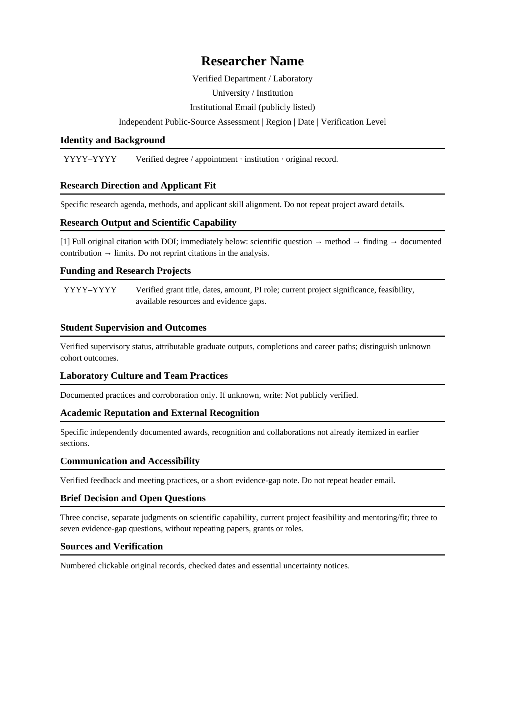

# Mentor Vetting

## Why Mentor Vetting?

Choosing an academic supervisor can be stressful and time-consuming. You may find yourself constantly switching between university websites, research databases, and other platforms, trying to gather enough information to make the right decision.

**Mentor Vetting was created to make this process easier.**

This open-source AI agent skill helps you research, evaluate, and compare potential academic supervisors. It brings relevant information together in an editable Word report, with links to original sources whenever available, saving you time on searching and shortlisting.

You can review the findings, verify the sources, and explore anything that interests you further. The goal is not to make the decision for you, but to help you make a more informed choice.

**To everyone searching for a supervisor, I sincerely wish you all the best. May you find someone who recognizes your potential, respects your ambitions, and supports you throughout your research journey.**

Your feedback, suggestions, and contributions are always welcome. I hope we can make Mentor Vetting more accurate, useful, and accessible to everyone.

[Contribute to this project](CONTRIBUTING.md)

**Current release:** [`v5.6.0-beta.1`](https://github.com/ruihan324/mentor-vetting/releases/tag/v5.6.0-beta.1) (pre-release).

## Key features

- **Identity-first verification** — disambiguates namesakes, name variants, ORCID records, and affiliation before attributing any achievement.
- **Eight-dimension evaluation** — research output and publication quality, grants and funding, student supervision and outcomes, laboratory and team culture, academic reputation, education and background, research agenda and applicant fit, and communication and accessibility.
- **Project-quality assessment** — separates achieved science from current project feasibility, available funding, staffing, and readiness.
- **Supervision and fit analysis** — evaluates mentoring evidence and research-direction fit for the applicant.
- **Source-linked reporting** — every key claim carries a working primary link and a verification status.
- **Rumor-safe** — unverified community anecdotes prompt questions, never accusations or fabricated facts.

## Supported education systems

- Mainland China
- United States
- United Kingdom
- Canada
- Australia
- New Zealand

Country-specific rules are loaded on demand so that programme policies, funding eligibility, and admission requirements are checked against actual institutional sources rather than assumed national rules.

## Installation

Copy the complete `mentor-vetting/` directory into your agent's skills folder, preserving `SKILL.md`, `references/`, `assets/`, and `scripts/`. Resource loading and Word generation vary by agent; consult your agent's documentation. The underlying directory format follows the [Agent Skills specification](https://agentskills.io/specification).

## Usage

Evaluate Professor B at University A.

## Sample Report Preview

Below is the original blank Word report template, showing its layout and section headings.

## Download

- **Source:** `Code → Download ZIP` on the repository home page, or `git clone https://github.com/ruihan324/mentor-vetting.git`.
- **Release package:** the complete skill archive `mentor-vetting-v5.6.0-beta.1.zip` is attached to the [v5.6.0-beta.1 release](releases/tag/v5.6.0-beta.1).

## Known limitations

- The skill is a **beta** pre-release and has not been tested end-to-end in every agent runtime.
- Public records cannot establish private laboratory conduct, current vacancies, or admission outcomes.
- Word generation and `references/` loading require agent support; `scripts/` are optional with manual fallback.
- Automated scripts validate declared data and document structure, not source truth or subjective judgment.
- Online DOI verification requires a live network connection and does not verify equal-authorship or independent-PI claims.

## Contributing

See [CONTRIBUTING.md](CONTRIBUTING.md). Bug reports, country-policy updates, and regression tests are welcome. Please read [SECURITY.md](SECURITY.md) before reporting privacy or safety issues.

## License

Released under the [MIT License](LICENSE). Copyright © 2026 Ruihan Sun (孙瑞涵).
